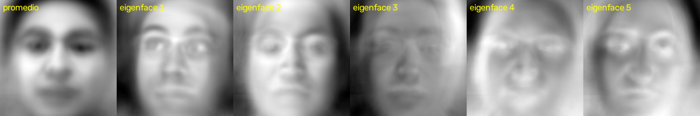
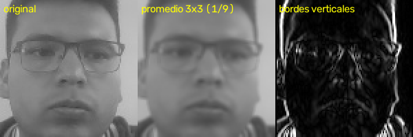

# Comparación: Eigenfaces, Fisherfaces y LBPH contra CNN

Los tres hacen lo mismo: se toma una foto de cara en grises de 100×100, se convierte en una lista de números y se compara con las caras que ya se conocen. `predict` devuelve la persona y una `confidence`, que es una **distancia** (mientras más baja, más parecida). Si queda debajo del umbral se muestra el nombre, y si no, "Desconocido".

Lo único que cambia es **cómo se convierte la cara en números**.

---

## Eigenfaces (PCA)

Una foto de 100×100 son 10,000 números, uno por píxel, y casi todos se repiten porque los píxeles vecinos se parecen. PCA encuentra las pocas direcciones en las que las caras más cambian entre sí. Vistas como imagen, son las _eigenfaces_.

**Con las fotos del proyecto.** Cada foto se aplana en una fila de 10,000 números. Estos son 4 píxeles del centro (fila 50, columnas 48 a 51) de tres fotos y su promedio:

| foto              | col 48 | col 49 | col 50 | col 51 |
| ----------------- | ------ | ------ | ------ | ------ |
| `cesare_1249.jpg` | 135    | 133    | 134    | 133    |
| `joseT_1308.jpg`  | 157    | 148    | 142    | 135    |
| `kike_1249.jpg`   | 125    | 126    | 126    | 124    |
| **promedio**      | 139.0  | 135.7  | 134.0  | 130.7  |

A `cesare` le quedan `[-4.0, -2.7, 0.0, 2.3]` al restar el promedio. Con las 2,798 fotos de entrenamiento (400 por persona), la primera eigenface explica el 31.4 % de la variación y con 63 componentes ya se llega al 90 %. O sea, 10,000 números se resumen en unas decenas.



Cada cara queda como una lista corta de números. Los primeros 5 de una foto de `cesare` son `[-3176, -1666, 2034, -711, -446]` y los de una de `kike`, `[-963, 213, -9, -294, 261]`: quedan lejos, y así se distinguen.

**Bueno:** sencillo de entender. **Malo:** muy sensible a la luz y a la alineación, porque PCA busca lo que más varía, no lo que separa a una persona de otra.

---

## Fisherfaces (PCA + LDA)

Es Eigenfaces con un paso más. Después del PCA se aplica **LDA**, que sí sabe quién es quién: busca las direcciones que **separan a las personas** y **juntan las fotos de la misma persona**.

Con 7 personas, cada cara queda en solo **6 números** (personas − 1). Por eso el modelo pesa 2 MB y predice en 0.52 ms, pero entrenarlo tarda más (unos 27 min, contra unos 21 min de Eigenfaces con las mismas fotos).

**Bueno:** en teoría aguanta mejor la luz y las expresiones. **Malo:** pide varias fotos por persona y es el más lento de entrenar.

---

## LBPH (patrones binarios locales)

No mira la cara completa, mira la **textura local**. Cada píxel se compara con sus 8 vecinos: si el vecino es mayor o igual, 1, y si no, 0. En `cesare_1249.jpg`, el píxel de la fila 40, columna 32 (brillo 78) tiene estos vecinos:

```
 79  74  78
 75 [78] 80
 94  95  95
```

Horario desde arriba a la izquierda: 1, 0, 1, 1, 1, 1, 1, 0 → `10111110` = **190**. Luego se hace un histograma de estos códigos por celda de la cara y se juntan todos en un vector, que se compara con el de las caras conocidas.

Aguanta la luz porque si toda la zona se aclara, las comparaciones no cambian y el código sigue siendo 190.

**Bueno:** entrena en unos 3 s y no necesita muchas fotos por persona. **Malo:** guarda un histograma por **cada foto de entrenamiento**; con las 17,317 fotos el modelo pesó 1.4 GB y OpenCV no lo pudo leer.

---

## Comparación con los datos del proyecto

Mismo split para los tres: **500 fotos por persona**, 80 % para entrenar (400 por persona, 2,798 en total) y 20 % para probar (100 por persona, 700 en total), con las 7 personas.

|                             | LBPH                                | Eigenfaces         | Fisherfaces        |
| --------------------------- | ----------------------------------- | ------------------ | ------------------ |
| Exactitud                   | **95.0 %**                          | 93.4 %             | 90.7 %             |
| Entrenamiento               | **3 s**                             | 1,248 s (≈ 21 min) | 1,592 s (≈ 27 min) |
| Predicción por foto         | 38.4 ms                             | 20.5 ms            | **0.52 ms**        |
| Tamaño del modelo           | 244 MB                              | 870 MB             | **2 MB**           |
| `tony` (el más difícil)     | 67/100                              | 56/100             | 49/100             |
| Umbral de ejemplo del curso | 70                                  | 2800               | 500                |
| En vivo con la cámara       | Funcionó bien, mejor que Eigenfaces | Asignó otro nombre | Reconoció bien     |

- **LBPH** ganó en exactitud y por mucho en tiempo de entrenamiento (3 s contra 21 y 27 min).
- **Fisherfaces** es el más lento de entrenar y el que sale con menos exactitud en la prueba, pero es el más ligero y rápido para predecir, y en vivo reconoció bien.
- **Los tres fallan con `tony`**: sus fotos se parecen a las de `kike` y `pau`.
- **Las distancias no se comparan entre métodos**, cada uno necesita su propio umbral.

Los tiempos se midieron con los tres métodos corriendo a la vez, así que pueden salir algo más altos de lo normal. La prueba también es optimista, porque las fotos de prueba vienen de las mismas sesiones que las de entrenamiento (misma luz y cámara). En vivo cambia el resultado: Fisherfaces, que salió último en la prueba, reconoció bien, y Eigenfaces, que salió segundo, asignó otro nombre.

---

## Contra CNN

Una CNN usa **convoluciones**: un **kernel** (cuadrícula chica de pesos) se desliza por la imagen, multiplica los píxeles por los pesos y suma. Cada kernel da un mapa de características, y al final unas capas deciden la clase.

**Con una foto del proyecto.** Un kernel de 3×3 con 1/9 en cada casilla es un **promedio**. Sobre un parche real de 4×4 de `cesare_1249.jpg` (filas 38 a 41, columnas 30 a 33):

```
 73  72  75  75
 76  79  74  78
 78  75  78  80
 98  94  95  95
```

El kernel cabe en 4 posiciones y la salida es de 2×2: `75.6, 76.2, 83.0, 83.1` (sumas de 680, 686, 747 y 748, entre 9). Aplicado a toda la foto desenfoca un poco, y un kernel de bordes deja solo los contornos:



En una CNN real los pesos **no se ponen a mano, se aprenden** con backpropagation.

|                       | Eigen / Fisher / LBPH                  | CNN                                         |
| --------------------- | -------------------------------------- | ------------------------------------------- |
| Características       | Fijas o estadísticas                   | **Las aprende de los datos**                |
| Datos                 | Cientos de fotos por persona           | Miles                                       |
| Entrenamiento         | Segundos a minutos en CPU              | Horas, con **GPU**                          |
| Luz, pose y expresión | Frágiles (Eigen), medio (Fisher, LBPH) | Mucho más robusta                           |
| Persona nueva         | Reentrenar                             | Se compara con _embeddings_, sin reentrenar |
| Explicarlo            | Fácil, se calcula a mano               | "Caja negra"                                |

Eigenfaces y Fisherfaces aplanan la foto en una fila; una CNN conserva la forma 2D. Los estudios que comparan CNN contra LBPH encuentran que la CNN es más estable, pero LBPH entrena más rápido y es más ligera.

**Para el proyecto:** que una cara se confunda cuando cambia la luz es una limitación típica de los métodos clásicos. Una CNN con muchos datos lo evitaría, pero con CPU y pocas personas **LBPH es la opción práctica** (entrena en segundos, y Fisherfaces tarda casi media hora para reconocer parecido en vivo), y la CNN sería el siguiente paso.
